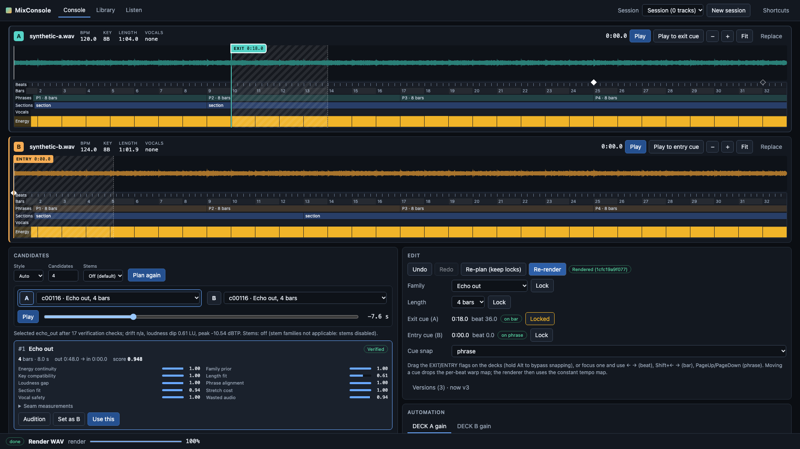
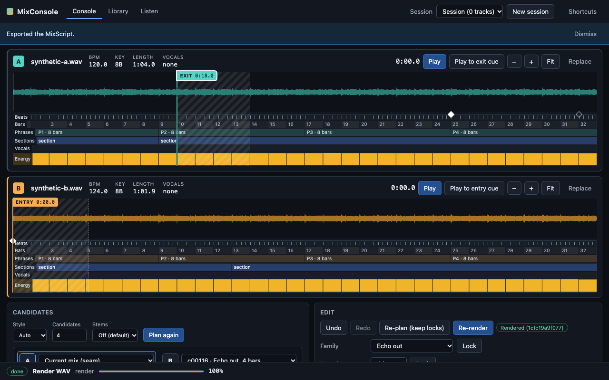

# Web console

`mixconsole serve --ui` serves a local web console on `127.0.0.1`. It is a thin client of the HTTP API
([API](api.md)): analysis, planning, verification and rendering all run in the engine; the browser only
shows and edits MixScript versions.

```sh
uv sync --dev --extra server
corepack enable && pnpm install && pnpm --dir apps/console build
uv run mixconsole serve --ui
```

Open the printed `http://127.0.0.1:8765/?token=...` URL. The token is moved to `sessionStorage` and
removed from the address bar. Nothing leaves your machine: no telemetry, no external fonts or CDNs.

## Workflow

1. **Load two tracks.** Drop or choose files on deck A (two files fill A then B), type a path on the
   server computer, or pick from the library. Dropped files are uploaded to the local server. Analysis
   starts when both decks are loaded and shows progress in the bottom bar.
2. **Decks.** Waveform (wavesurfer.js) with lanes for beats, bars, phrases, sections, vocals and bar
   energy, zoom, per-deck transport and cue markers.
3. **Plan.** Choose style, candidate count and stems (`off` default, `auto`, `on`; stems need the
   `stems` extra) and press *Plan mix*: the engine plans, verifies and renders. Each candidate card shows
   family, length, score and its breakdown, and its verification status; unmeasured metrics read `n/a`.
4. **Audition.** Play a candidate preview or the seam of the current mix. Two slots, A and B, keep the
   position relative to the handoff when you switch (keys `A`, `B`).
5. **Edit.** Drag the EXIT and ENTRY flags (snap to phrase, downbeat or beat; Alt bypasses). Change family
   or length (re-plans with that field locked), lock fields, edit gain/EQ/filter automation points. Every
   edit is a new append-only MixScript version, so undo/redo only moves between versions.
6. **Render and export.** *Re-render* renders the version on screen; export WAV, FLAC, MixScript or the
   report.
7. **Library and Listen.** The library lists analysed tracks (search, BPM range, Camelot key, sort by BPM,
   key, energy, loudness, length). *Listen* opens a kit built by `mixconsole listen build`, plays it blind
   and saves `listen-votes/v1` JSON for `mixconsole listen results`.

## Shortcuts

Press `?` in the console. Space plays the active deck, `1`/`2` select a deck, `+`/`-`/`0` zoom, `P` plans,
`R` re-renders, `A`/`B`/Enter audition, arrow keys move a focused cue (Shift: bar, PageUp/PageDown:
phrase), Ctrl/Cmd+Z undo, Shift+Z redo, Alt+1/2/3 switch view.

## Screenshots (synthetic audio only)





## Limits

- Moving a cue drops the per-beat warp map of that transition; the renderer then uses the constant
  tempo map, which can be less tight for beatmatched families.
- A re-plan with locked cues only succeeds when the planner has a candidate at those exact cues.
- Audition of the seam needs a render of the current version; candidate previews only exist for the plan
  made by *Plan mix*, not for later re-plans.
- The stems choice applies to planning and verification; analysis processes use the server setting.
- The listening page reads the kit folder in the browser; it is not hosted by the server.
